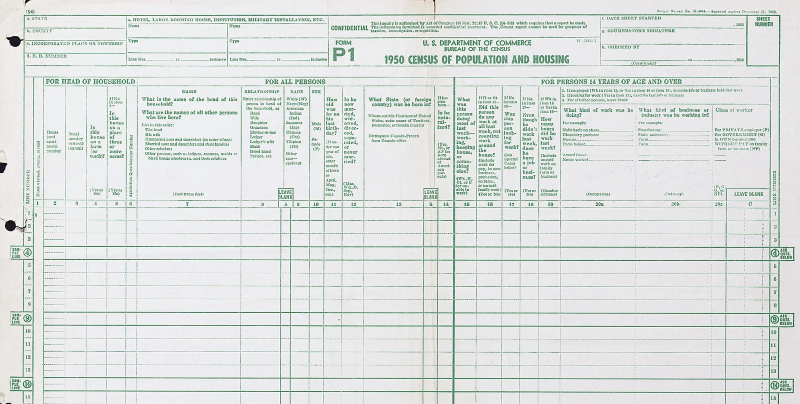

*The 1950 census population schedule recorded name, age, marital status, and birthplace of everyone, and asked more detailed questions of six people per page.*

1950 Census population schedule, U.S. Census Bureau. Public domain. [Source](https://www.census.gov/library/photos/1950a.html)

# Census

First-party tracking, shown to the person being tracked.

Census is a single page that shows what a website learns about you on your first visit, as it happens. It asks for consent, then records what a customer data platform such as Segment would collect about the visitor, and prints each event in a terminal panel next to the explanation. It runs on your own domain and loads no third-party scripts.

It works two ways. Out of the box it is an explainer: everything stays in the browser and nothing is sent anywhere. Turn on an output and it becomes a first-party tracking layer you can deploy: your own server forwards the same events to your Segment workspace, RudderStack data plane or webhook, and the visitor sees exactly what is sent, where and when, while it is being sent.

---

## Why you would want this

As an explainer:

- **Explaining CDPs.** Clients and stakeholders see their own data become a profile instead of reading a diagram about it.
- **Onboarding marketers to event specs.** Every event is a real `page`, `track` or `identify` call in Segment's format, with the fields filled in.
- **A reference for destination mappings.** The same event is reshaped for GA4, the Meta Conversions API, HubSpot and a warehouse row, side by side.
- **Privacy education.** It shows what a first-party script can read, and what it cannot.

As a tracking layer:

- **Tracking you can show.** Visitors see the consent screen name each tool that receives their events, then watch every batch leave, with the exact JSON each tool got and its answer.
- **Real events in your own pipeline.** The same `page`, `track` and `identify` calls land in Segment, RudderStack or your own endpoint, so a demo or landing page also feeds your CDP.
- **No keys or vendor scripts in the browser.** Events go to your own server first, which drops the IP by default and holds the keys.
- **A small starting point.** Each output is one short file, so adding another tool means writing one function.

---

## Quickstart

You need Node 22 or later.

```bash
git clone https://github.com/jcgaal/census && cd census
npm install
npm run dev
```

Open `http://localhost:5173` and click **Start**, or open `http://localhost:5173/?sample=1` to see the page with sample data and collect nothing. Add `?lang=es` for Spanish.

Vite serves the page and proxies `/api` to the Node server on port `3001`. Location stays empty on `localhost`, because private IPs are never looked up.

---

## What it collects

Nothing runs before the consent gate. After **Start**, each section explains one kind of data and the terminal prints what was actually read.

| Section | What it shows |
|---|---|
| 00 Consent | A choice between real data and sample data. Nothing is collected before it. |
| 01 Identity | A random anonymous ID in a first-party cookie, and how later events attach to it |
| 02 Origin | URL, UTM parameters and referrer, and how they become attribution |
| 03 Device | Browser, OS, screen, language, time zone and a few accessibility and privacy settings |
| 04 Location | The IP address and approximate location from the request to `/api/context` |
| 05 Behavior | A live stream of section views, clicks, scroll depth and time on page |
| 06 Identity resolution | An email form that merges the anonymous history into a named profile. The email stays in the browser unless an output is enabled, and the form then says where it goes. |
| 07 Destinations | The latest event reshaped for GA4, Meta, HubSpot and a warehouse. Preview only. |
| 08 Limits | What a web page cannot see |
| 09 Closing | Optional, your own text. Hidden unless you enable it. |

What it cannot see, as section 08 lists it:

| Cannot see | Why |
|---|---|
| Cookies from other websites | Browsers isolate them by design |
| Your browsing history | Not exposed to websites |
| Files, photos, contacts, messages | Not accessible from a web page |
| Your name or email before you type it | Only after a form or login |
| Your precise location | Only with your explicit permission |

---

## Configuration

Everything is optional. Copy `.env.example` to `.env` and set what you need. `VITE_` variables are compiled into the page, so change them before `npm run build`. With nothing set, the page names no company and section 09 is hidden. The output variables are covered in [Sending events to your CDP](#sending-events-to-your-cdp).

| Variable | Default | Purpose |
|---|---|---|
| `VITE_SITE_NAME` | `Census` | Name in the header, page title and footer |
| `VITE_OWNER_NAME` | empty | Name in the footer copyright and the section 09 contact button. Empty hides the copyright line. |
| `VITE_LOGO_URL` | empty | Logo next to the name. Serve it from your own domain. |
| `VITE_OG_IMAGE_URL` | empty | Social preview image |
| `VITE_COOKIE_PREFIX` | `census` | Cookie `<prefix>_anon_id`, storage keys `<prefix>_profile` and `<prefix>_consent` |
| `VITE_DEFAULT_LANG` | `en` | Language for browsers set to neither English nor Spanish |
| `VITE_CLOSING_ENABLED` | `false` | Shows section 09 |
| `VITE_CLOSING_TITLE_EN`, `_ES` | empty | Section 09 title. Spanish falls back to English. |
| `VITE_CLOSING_BODY_EN`, `_ES` | empty | Section 09 text. One paragraph per line (a literal `\n` also counts), `**bold**` allowed. |
| `VITE_CONTACT_EMAIL` | empty | Contact links in the header, footer and section 09 |
| `VITE_LINKEDIN_URL` | empty | LinkedIn link in the footer |
| `VITE_EXTRA_LINK_LABEL`, `_LABEL_ES`, `_URL` | empty | One extra link, for example to another demo, in the header, footer and section 09 |
| `VITE_REPO_URL` | this repository | Where the fork buttons point. Set it to your fork. |
| `GEO_PROVIDER_URL` | empty | Server only. IP geolocation lookup, with `{ip}` as a placeholder. |
| `PORT` | `3001` | Server only. Port for `npm start`. |

### Location

The server looks for location in this order:

1. Host headers. Vercel's `x-vercel-ip-*` headers and Cloudflare's `cf-ipcountry` work with no setup. Cloudflare needs the "Add visitor location headers" managed transform for region and city.
2. `GEO_PROVIDER_URL`, when set. Responses shaped like ipapi.co, ipinfo.io or ip-api.com are understood. The lookup gives up after 2.5 seconds.

```bash
GEO_PROVIDER_URL=https://ipapi.co/{ip}/json/
```

With neither, section 04 shows the IP only. With a provider set, every visitor IP is sent to it. Tell your visitors if you turn it on.

---

## Adding a destination

Each destination is one file in `src/destinations/` that turns the latest event into a preview, plus one line in the registry. For example, a generic webhook:

```ts
// src/destinations/webhook.ts
import type { Formatter } from './types';

export const webhook: Formatter = (input) => ({
  name: 'Webhook',
  endpoint: 'POST https://example.com/hooks/census',
  body: input.event && {
    type: input.event.type,
    event: input.event.event ?? null,
    anonymousId: input.event.anonymousId,
    userId: input.identify?.userId ?? null,
    properties: input.event.properties ?? {},
    timestamp: input.event.timestamp,
  },
});
```

```ts
// src/destinations/index.ts
export const destinations: Formatter[] = [ga4, metaCapi, hubspot, warehouse, webhook];
```

Formatters build payloads for display only. Do not add a request: the page promises that destinations send nothing. To actually send events somewhere, write an output instead (see [Writing an output](#writing-an-output)).

---

## Sending events to your CDP

An output is a tool your server forwards events to: Segment, RudderStack or any webhook. Outputs are off by default. With none configured, the page sends nothing anywhere and the copy says so. When you set one, Census becomes a tracking layer: the page forwards the same events it shows, and only those.

How it works:

1. The visitor presses **Start**. Before that, and in sample mode, nothing is sent.
2. The page batches events (at most one request a second, plus one with `keepalive` when the tab is hidden) and posts them to `/api/collect` on its own origin. The browser never talks to a CDP and never holds a key.
3. The server checks each event against the fields the page's event builder produces, removes the IP and forwards the batch to every enabled output, with a 3 second timeout and no retries.
4. The terminal prints every send: the events, each output's name and host, the exact JSON it received and the result.

| Output | Variables | Request |
|---|---|---|
| Segment | `SEGMENT_WRITE_KEY`, optional `SEGMENT_ENDPOINT` (default `https://api.segment.io`; EU workspaces use `https://events.eu1.segmentapis.com`) | `POST {endpoint}/v1/batch`, Basic auth with the write key as username, body `{ "batch": [...] }` |
| RudderStack | `RUDDERSTACK_WRITE_KEY` and `RUDDERSTACK_DATA_PLANE_URL` | Same as Segment, against `{data plane}/v1/batch` |
| Webhook | `WEBHOOK_URL`, optional `WEBHOOK_SECRET` | `POST { "events": [...] }`. With a secret, `X-Census-Signature` holds the HMAC-SHA256 of the body as hex. |

Other settings:

| Variable | Default | Purpose |
|---|---|---|
| `OUTPUT_FORWARD_IP` | `false` | `true` adds the visitor's IP as `context.ip`. Otherwise no IP is forwarded, and Segment and RudderStack get `0.0.0.0` (RudderStack also gets `request_ip: "0.0.0.0"`) so they do not record the server's address in its place. |
| `COLLECT_RATE_LIMIT` | `60` | Requests per IP per minute on `/api/collect`. See [Rate limit](#rate-limit). |

### Build time and run time

The consent screen has to name the outputs before the visitor agrees to anything, so the build bakes each output's name and host into the page. Keys, secrets and URL paths never go into the page. The server reads the full settings when it runs.

| Variable | Read at build time | Read at run time |
|---|---|---|
| `SEGMENT_WRITE_KEY`, `RUDDERSTACK_WRITE_KEY` | Only to see which outputs are on, when `CENSUS_OUTPUTS` is not set. The values are never baked in. | Yes |
| `WEBHOOK_SECRET` | No | Yes |
| `SEGMENT_ENDPOINT`, `RUDDERSTACK_DATA_PLANE_URL`, `WEBHOOK_URL` | Only the host, when `CENSUS_OUTPUTS` is not set | Yes |
| `CENSUS_OUTPUTS` | Yes, and it replaces the variables above for the build | No |
| `OUTPUT_FORWARD_IP` | Yes, for the consent text | Yes |
| `COLLECT_RATE_LIMIT` | No | Yes |

The build finds the outputs in one of two ways:

- **From the output variables.** On Vercel and Cloudflare Pages, project environment variables are available to the build and the functions alike. With `npm run build` on your own host, have them in `.env` or the environment.
- **From `CENSUS_OUTPUTS`**, a public list of `Name=host` pairs, for builds that should not see any key. Names are `Segment`, `RudderStack` and `Webhook`; hosts are written as the server will report them, lowercase, with the port only when it is not the default. For example `CENSUS_OUTPUTS=Segment=api.segment.io,Webhook=hooks.example.com`. When it is set, the build uses it and ignores the other output variables. A malformed entry stops the build, and the error gives only the entry's position, so a key pasted there by mistake is not printed in the build log. Docker uses this route (see [Docker and outputs](#docker-and-outputs)).

### When the build and the server disagree

After **Start**, `/api/context` reports the server's outputs and its `OUTPUT_FORWARD_IP` setting. The page starts sending only if both match what the consent screen said, so a visitor is never told one thing while the server does another. Until then, events wait in the page.

- **Mismatch.** A different output, host or IP setting. Nothing is sent, and the terminal prints "outputs not used: the server's output settings differ from what the consent screen said".
- **No answer.** `/api/context` fails or cannot be reached, as on a static host. Nothing is sent, and the terminal says the server could not confirm the outputs.

So after changing outputs, rebuild as well as restarting the server.

### What the visitor sees

- The consent screen names each output and its host, and says whether the IP is forwarded.
- Section 06 says the email goes to those outputs with the identify call.
- Section 07 keeps its previews and adds "Also sent to {name} ({host})".
- The terminal prints a `POST /api/collect` block for every batch: the events, then for each output its name, host, result (sent, or failed with the HTTP status or "no response") and the exact JSON it received.
- The footer says events go only to the outputs named on the consent screen.

### Forget me and outputs

**Forget me** stops further sends at once and drops any events still waiting in the page. It cannot delete what was already sent: that data stays in the output and has to be deleted there, and the terminal says so. A batch already on its way when the button is pressed still arrives. Sample mode never sends anything.

### Rate limit

`COLLECT_RATE_LIMIT` counts requests per IP per minute in each server's memory. Each address is dropped once its minute is over and is never written or logged. On Vercel, Cloudflare or any setup with several instances, every instance keeps its own count, so the real limit across instances is higher than the number you set. Put your platform's own rate limiting in front if you need a hard cap.

### Writing an output

Each output is one file in `server/outputs/` that returns `null` when its variables are missing, plus one entry in the registry in `server/outputs/index.ts`. The webhook is the shortest:

```ts
// server/outputs/webhook.ts
import { httpUrl, postJson, type CollectEvent, type Output, type OutputEnv } from './types.js';

export function webhookOutput(env: OutputEnv): Output | null {
  const url = httpUrl(env.WEBHOOK_URL);
  if (!url) return null;
  const secret = env.WEBHOOK_SECRET?.trim();
  return {
    name: 'Webhook',
    host: url.host,
    async send(events: CollectEvent[]) {
      const body = { events };
      const text = JSON.stringify(body);
      const headers: Record<string, string> = secret ? { 'X-Census-Signature': await hmacHex(secret, text) } : {};
      return postJson('Webhook', url.host, url.toString(), body, headers, text);
    },
  };
}
```

```ts
// server/outputs/index.ts
const builders = [segmentOutput, rudderstackOutput, webhookOutput];
```

`hmacHex`, in the same file, signs the body with Web Crypto, which Node, Vercel and Cloudflare all provide. `postJson` handles the timeout and turns the answer into the result the terminal prints. Add the new variables to `OutputEnv` in `server/outputs/types.ts`. An output only ever receives events that already passed validation and IP removal, and must not log them.

---

## Deployment

| Host | How | Location |
|---|---|---|
| Vercel | Import the repository. Vercel builds the Vite app and serves `api/context.ts` and `api/collect.ts` as functions. | Free, from headers |
| Cloudflare Pages | Build command `npm run build`, output directory `dist`. `functions/api/context.ts` and `functions/api/collect.ts` become the endpoints. | Country free; region and city need the visitor location managed transform |
| Any Node host (Render, Fly.io, Railway, a VPS) | `npm run build && npm start` runs `server/node.ts`, which serves `dist/`, `/api/context` and `/api/collect`. Set `PORT` if the host assigns one. | Needs `GEO_PROVIDER_URL` |
| Docker | `docker build -t census . && docker run -p 8080:8080 census`. Listens on `8080`, with `/health` for health checks. For outputs, see [Docker and outputs](#docker-and-outputs). | Needs `GEO_PROVIDER_URL` |
| Static only (GitHub Pages, Netlify without functions) | Upload `dist/`. | None. Sample mode works; in live mode section 04 reports that `/api/context` could not be reached. Outputs need a server, so none are sent. |

### Docker and outputs

The image is built without your `.env` (see `.dockerignore`). The build stage takes two build arguments, both public: `CENSUS_OUTPUTS`, the output names and hosts for the consent screen, and `OUTPUT_FORWARD_IP`. Keys, secrets and full webhook URLs are never build arguments: pass them to the container when it runs.

```bash
docker build -t census \
  --build-arg CENSUS_OUTPUTS=Segment=api.segment.io,Webhook=hooks.example.com \
  .
docker run -p 8080:8080 \
  -e SEGMENT_WRITE_KEY=... \
  -e WEBHOOK_URL=https://hooks.example.com/... \
  -e WEBHOOK_SECRET=... \
  census
```

Build arguments are recorded in the image history, which is why only names and hosts go there. If the runtime variables do not match the build arguments, the page sends nothing and says so in the terminal. Without `CENSUS_OUTPUTS`, the image has outputs off whatever you pass at run time.

On a Node host or in Docker, put the server behind a proxy that sets `X-Forwarded-For`. The server reads the first address in that header as the visitor's IP.

---

## Privacy

- **Consent gate.** Nothing is read, stored or requested before the visitor clicks **Start**. Sample mode collects nothing and requests no location.
- **First-party cookie.** One cookie, `census_anon_id` (365 days, `SameSite=Lax`), and two local storage keys, `census_profile` and `census_consent`. The prefix follows `VITE_COOKIE_PREFIX`.
- **Nothing leaves the browser unless you enable an output.** By default the only request the page makes is `GET /api/context`, after consent. With an output enabled, events also go to `POST /api/collect`, only after consent, only through the site's own server, without the IP unless `OUTPUT_FORWARD_IP=true`, and every send is shown to the visitor in the terminal.
- **Nothing stored server side.** Responses are marked `no-store`, no request logger is mounted, and the IP exists only for the length of a request, except that the `/api/collect` rate limit keeps it in memory for at most a minute. Event payloads are forwarded and never kept or logged.
- **No keys in the browser.** Output keys, secrets and webhook URLs stay on the server. The page knows only each output's name and host.
- **Host logs.** Your hosting platform (Vercel, Cloudflare or your own server) may keep its own access logs that include IP addresses. This app has no control over those.
- **Forget me.** The button in the header deletes the cookie and both storage keys. Language lives in the URL, not in storage. With an output enabled it also stops further sends, but data already sent stays in that output and has to be deleted there.
- **No third-party scripts.** No analytics, pixels, tag managers or font CDNs. Fonts are bundled with the page.

---

## Not affiliated

Census is not affiliated with Segment, Google, Meta or HubSpot. Their names appear only to describe the formats the page mirrors.

---

## License

MIT. See [LICENSE](LICENSE). Security reports: see [SECURITY.md](SECURITY.md).

The header image is a U.S. federal government record in the public domain, credited above.
